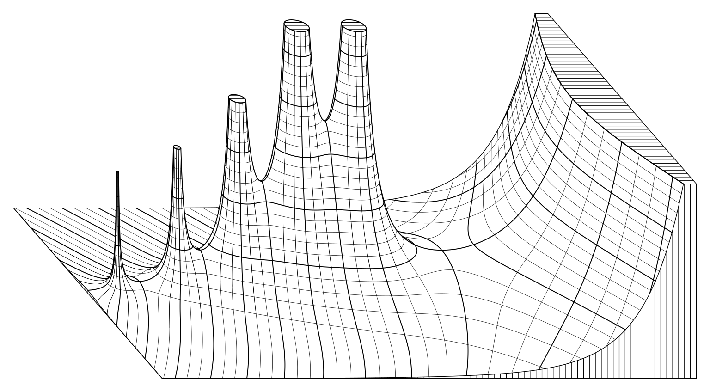
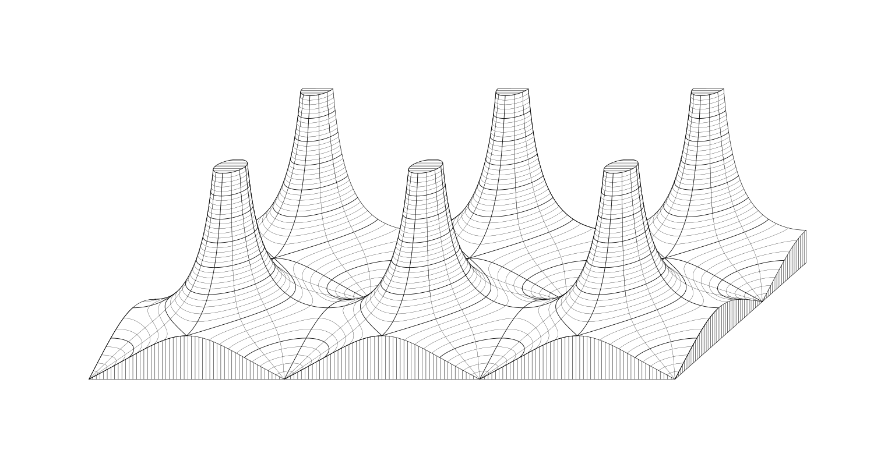
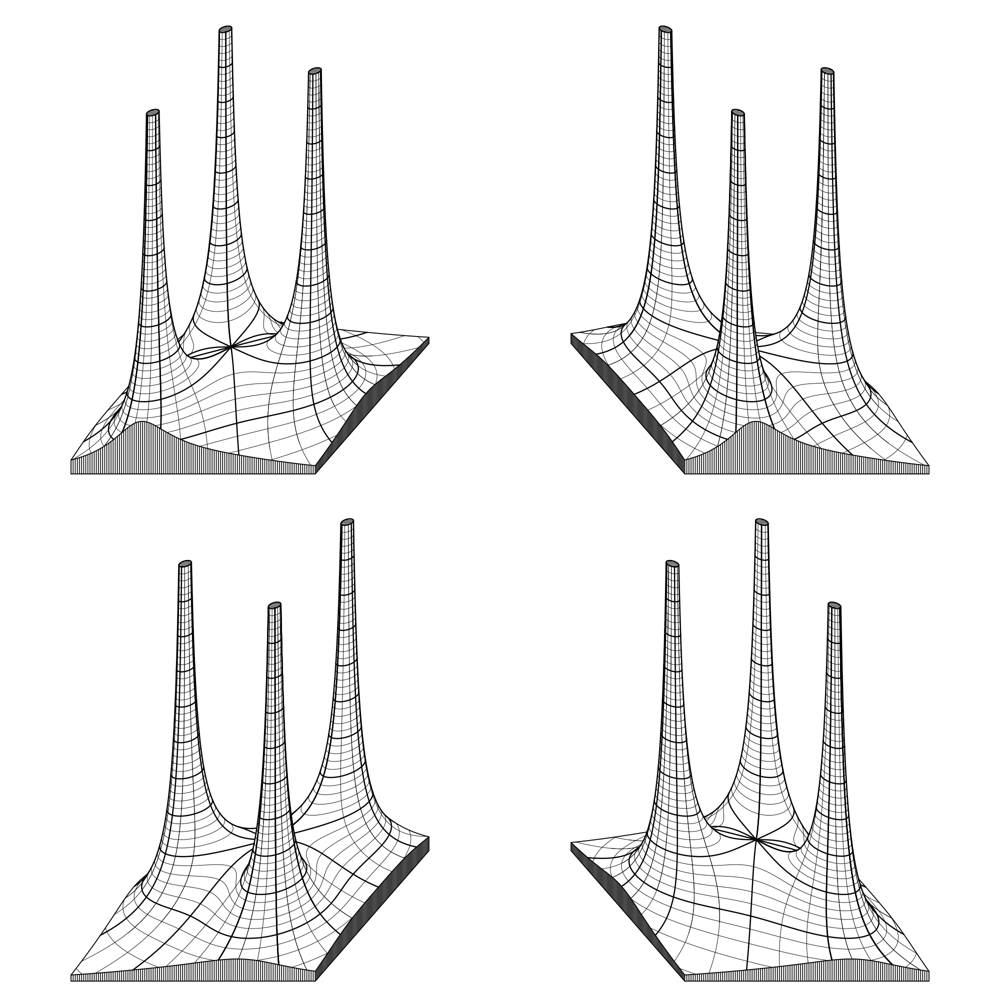

# kurven

Analytic landscapes in the manner of Jahnke and Emde's *Tafeln höherer
Funktionen* (1909). Given a meromorphic function f of z = x + iy as a
formula, kurven draws its modulus surface, the graph of |f| over the complex
plane, with the level curves of |f| and arg f on it and every hidden part
left out.



- **Every line is a level curve.** Modulus lines |f| = c and phase lines
  arg f = θ are found on a grid, then solved for on the function itself: each
  vertex lies on the level curve, and each chord is subdivided until its
  midpoint is within a fiftieth of a grid cell of it.
- **Hidden lines are decided exactly.** A point is hidden where the solid
  under the surface lies between it and the viewer. That is tested by
  marching along the projection direction through the solid, not by a depth
  buffer, so the drawing is the same at any resolution.
- **The output is a vector drawing.** SVG polylines, nothing rasterized.

## Gallery

**Γ(z)**, above: the published plate's window and camera, Re z ∈ [−4.5, 4.5],
|Im z| ≤ 2.5, each spire truncated at its own height.

**cn(z, 0.64)**, the Jacobi elliptic function, over three by six quarter
periods. A spire rises at each pole, every one truncated at |cn| = 4.



**1/(z³ − 1)** from four sides, each drawn as the plates are drawn: the front
face head-on, the depth receding at a slant to the right or to the left.



## Try it

kurven needs macOS 15 or later and the Swift toolchain (the Command Line Tools
are enough; no Xcode, no other dependencies).

```bash
swift build -c release --package-path KurvenSwift
KurvenSwift/.build/release/kurven-cli landscape "1/(z^3 - 1)" \
    --re -1.3,1.6 --im -1.2,1.5 --cap 5 -o cubic.kurven
KurvenSwift/.build/release/kurven-cli bake cubic.kurven -o cubic.svg
```

Or the app, with a picker of fourteen functions drawn as pictures, sliders for
the window and the truncation, and a camera you can orbit:

```bash
scripts/bundle-app.sh && open build/Kurven.app
```

## Any function

The expression language has 43 functions, implemented natively: Γ, ψ, ζ, the
error functions, Bessel and Airy, Lambert W, the Jacobi elliptics, and the
elementary ones.

```
gamma(z)      1/Γ(z)        zeta(z)        exp(1/z)      z^3 - 1
tan(z)        sin(z)cn(z, 0.64)            (z^2-1)/(z^2+1)          z!
```

Every number in an expression is a slider in the app: `besselj(2, z)` gets
one labelled *Order*. See [docs/landscapes.md](docs/landscapes.md).

## How it works

The function is sampled on a grid, and marching squares finds the level
curves of |f| and arg f there. Each vertex is then moved along its grid edge
to the exact crossing of the level curve, by a root find of |f| − c (or
arg f − θ) bracketed by the edge's two samples, and each chord is subdivided until it stays within tolerance of the curve. The
curves are lifted onto the modulus surface.

The solid is the region between the plane and the surface, truncated at a
height h(x) that is constant on bands in Re z. Let d be the projection
direction, pointing away from the viewer, and n the surface normal. A point
is visible when the surface faces the viewer there (n · d < 0) and a march
from it toward the viewer, along −d, never enters the solid. The fold curve,
where n · d = 0, is where the projection of the surface onto the picture
folds over; its image is the outline. It is found from the same normal for
each camera. Finally everything
is projected obliquely, as the 1909 plates were.

[docs/architecture.md](docs/architecture.md) goes through each stage.
[docs/development.md](docs/development.md) covers building, the tests and the
layout of the code.

## Where it came from

The hidden-line drawing is older than this repository. It was written in two
notebooks at the start of 2024, in the author's public
[notebooks](https://github.com/willishoke/notebooks) repository:

- [`zbuffer.ipynb`](https://github.com/willishoke/notebooks/blob/main/zbuffer.ipynb)
  (commit `b7759bb`, 2 January 2024): a Z-buffer over a Delaunay
  triangulation, with the depth of a point inside a triangle taken from its
  barycentric coordinates.
- [`3d_mtn_contour.ipynb`](https://github.com/willishoke/notebooks/blob/main/3d_mtn_contour.ipynb)
  (commit `d1bdeb9`, 3 January 2024): the same occlusion applied to contours
  of a USGS elevation grid of Mount Hood, the same pipeline with a mountain in
  place of a function.

This repository began in June 2026 as the gamma notebook turned into a
Python program, which took about a minute to draw the plate on a GPU and ten
on a CPU, with nothing to look at in between. It is now a different program:

- **A realtime renderer in Swift and Metal.** The app redraws on the
  display's clock, up to 120 Hz: a full preview frame at 3200² takes 6.8 ms
  for the elliptic plate.
- **An expression language.** Any function you can type is a landscape. The
  special functions are evaluated natively and checked against scipy, and
  every number in an expression becomes a control in the app.
- **Edits in milliseconds.** A new function is sampled in about 10 ms (70 ms
  for ζ). A change of truncation height, contour levels or hatching shows up in the next
  frame.
- **Exact lines.** Contours are placed on the function itself, not read off a
  grid of samples, and an exact test on the surface replaced the depth buffer
  as the judge of what is hidden.

## References

- Jahnke, E. & Emde, F. (1909). *Tafeln höherer Funktionen*. Teubner.
- Needham, T. (1997). *Visual Complex Analysis*. Oxford University Press.
