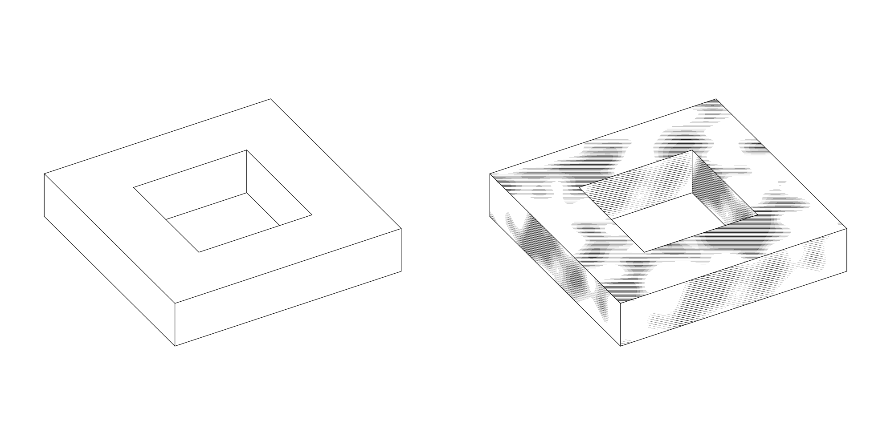

# Polyhedra

`kurven-cli surface solid` draws a polyhedron: its edges, and optionally
hatching on its faces. Visibility is solved in closed form, with no pixel
and no grid involved, so the drawing is the same at any resolution.



```bash
kurven-cli surface solid --kind frame --size 2 --hole 2 --depth 0.8 -o frame.svg
kurven-cli surface solid --kind dodecahedron --hatching half-lambert --width-steps 4 -o d.svg
```

## Faces and their pieces

A `Solid` is given as vertices and its faces in boundary representation,
each face as its loops (`Solid(vertices:faces:)`): the outer loop
counter-clockwise seen from outside, then one loop per hole, clockwise. The
constructor checks that every face is flat, that no two loops of a face
share a vertex, that every edge is shared by exactly two faces in opposite
directions, that the signed volume is positive, and that no two faces
sharing an edge lie in one plane (they would be one face); anything else is
refused.

A face is flat when every vertex lies within its *flatness tolerance* of
the face's plane: a billionth of the face's extent, the diagonal of its
bounding box in its plane, so the check is the same wherever the solid
stands. A coordinate holds only half a unit in its last place, though, so
the tolerance never falls below a few units in the last place of the face's
largest coordinate per vertex: a millimetre face a million units out is
held to the 1e-10 its coordinates carry, not to 1e-12. `isConvex` measures
every vertex against every face's plane the same way, at the size of the
whole solid.

A loop is one component of the face's boundary. Where a face touches
itself at a vertex, the loop there passes the vertex twice: a hole that
touches the outer loop is part of the outer loop, and two holes that touch
each other are one hole. A square `[0, 1, 2, 3]` with a triangular hole
touching its corner 0 is the single loop `[0, 1, 2, 3, 0, 4, 5]`. Written
this way, the holes Euler–Poincaré counts are the boundary's components;
written as two loops, the touching hole would be counted once too often.

Visibility and hatching both reduce to clipping a line against a convex
polygon, which is an intersection of half-planes, so the solid cuts every
face into *convex pieces* (`ConvexPartition`):

1. The holes are joined in one at a time, each by a *bridge*: the
   shortest segment that stays inside the face from one of its vertices to
   a vertex of the polygon built so far, which is the outer loop and the
   holes already joined. The face becomes one polygon that runs along each
   bridge twice.
2. That polygon is cut into triangles by ear clipping.
3. Hertel and Mehlhorn (1983): every diagonal whose two ends stay convex
   without it is removed, which merges its two pieces. For a face without
   holes this gives at most four times the fewest pieces possible.

No vertex is added, so the pieces' sides meet the neighbouring faces' sides
end to end. Every choice is made in index order, so a face is cut the same
way in every process. A convex face with no hole is a single piece.

A side shared by two pieces of one face is a *diagonal* of the partition.
A diagonal is not an edge of the solid: it is never drawn and never hides
anything.

The picture frame (`Solid.frame`) is the case that needs this. Its front
and back are square annuli, an outer square and a square hole, and each is
cut into four pieces. Counted as boundary representation, the frame has 16
vertices, 24 edges and 10 faces, two of them with a hole, and
Euler–Poincaré gives 16 − 24 + 10 − 2 = 0: one shell of genus one. Counted
over the partition, it is 16 vertices, 32 sides and 16 pieces, and
16 − 32 + 16 = 0 as well.

## Visibility

An edge is seen where one of its two faces faces the eye and nothing stands
in front. The first half is two signs. On a convex solid it is the whole
test, and every edge is drawn whole or not at all.

On the Császár torus and the frame, an edge can pass behind a piece
elsewhere on the solid, so it is tested against every other piece
(`Solid.Occlusion`). Under the orthographic camera a segment and a piece
both project to flat regions of the page. Their overlap along the segment is
an interval, and over it the difference of their view depths is linear, so
the hidden part of the segment is an interval found in closed form. The
frame's back inner edges, seen through the hole and cut by the front, are
the test case.

Curves on a face, such as hatching, are tested the same way, against every
piece outside their own face (`Solid.visibleCurves`). A face seen edge-on
draws none: it projects to a line, which is the edges' to draw
(`Occlusion.isEdgeOn`).

## Hatching

`Hatching` is a family of parallel lines at an angle and a spacing, whose
width is set by a tone. On a solid every face is hatched in its own plane:

- The face gets a frame: its origin is the centroid of its vertices and its
  `u` axis runs along the first side of its outer loop (`Solid.FaceFrame`).
- Lines run at the hatching's angle to `u`, through the multiples of the
  spacing, so a face's hatching depends only on the face, not on how it was
  partitioned.
- Each line is clipped to every piece of the face and the intervals are
  joined where they meet. Two pieces compute their shared diagonal's
  crossing from the same two vertices, but not always to the same bit, so
  intervals within 1e-12 of the face's extent are joined and a hatch line
  crosses a diagonal unbroken.
- A line lying on a side of a piece is outside it when the side is an edge,
  so the edge is drawn and no hatch line over it, and inside it when the
  side is a diagonal, so a line along a diagonal is drawn once.
- The tone is read along each line every `step`. Where the width changes
  between two readings, the change is bisected on the tone until the
  midpoint no longer moves, so a line ends on the tone's level set rather
  than at the nearest reading.

The tone is a function on the face with values in [−1, 1]; lines are drawn
where it is positive. With one width step the layer is drawn at its width
wherever the tone is positive. With n width steps the tone in (0, 1] is cut
into n bands and the bake writes one layer per band, at k/n of the width.

| tone | value |
|---|---|
| uniform | 1 everywhere |
| Turing | Turing's dappled pattern, in face coordinates divided by a scale |
| half-Lambert | (1 − n·l)/2 for the face's normal n and the unit direction l toward the light: the darkness under half-Lambert shading |

Turing's pattern is the closed form behind the dappled figure of Turing's
"The chemical basis of morphogenesis" (1952), as reconstructed in
"Turing Patterns" (willishoke.github.io, 2022):
f(x, y) = Σ U(r, s) exp(−((x − hr)² + (y − hs)²)/2) with h = 0.7 and each
U(r, s) = ±1. The signs come from a hash of the lattice point and a seed,
so the pattern is defined on the whole plane with no array behind it. It is
not a simulation of reaction and diffusion.

Hatching on a heightfield's walls and plateaus is the same `Hatching` value
laid on different faces (`HatchedFaces`). There, lines are vertical on a
wall and along an axis on a plateau, and a manifest that asks for a tone
other than uniform, or for more than one width, is refused
([landscapes.md](landscapes.md)).

## Tests

`Sources/kurven-test/Solids.swift` and `Hatchings.swift` hold the occlusion
test to a brute-force ray cast against every piece, point by point along
every edge and every hatch line, under 38 cameras, including through the
frame's hole. They also check that a hatch line ends on the tone's level set
to the bisection's resolution, that no hatch line ends on a diagonal, and
that a bake at 64 pixels is the bake at 2048, layer for layer.

The partition is checked on the frame and on prisms over faces that make it
work: an L, a comb, a square with two holes, a hole close to the outer loop, a star
with a triangular hole, and loops with straight corners. On every face the
pieces are convex and made of the face's own vertices, their areas add up
to the face's, a grid of sample points lands in exactly one piece inside
the face and in none outside, and the diagonals number pieces − 1 + holes,
which is Euler's formula for a disc with holes cut into discs. Each prism's
edges are held to the ray cast, and each face is cut again at a hundredth
the size, 1000 from the origin, into as many pieces. A star, a comb and a
spiral strip of thousands of corners are each cut in well under a second. Two boxes
with pits sunk in their tops test faces that touch themselves: one pit
touches the top face's outer loop at a corner, and two pits touch each
other at a corner of their mouths. Both are spheres, χ = 2, and their edges
agree with the ray cast.

A millimetre cube and picture frame, tilted and millions of units out,
where rounding alone bends a face by more than a billionth of it, are
accepted and partitioned as at the origin; and a prism whose side is dented
by 1e-4 is not convex there, though a billionth of its distance from the
origin is more than ten times the dent.
